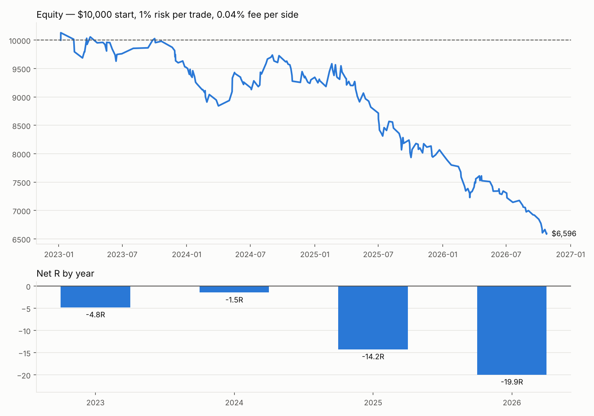

# Trading15 — BTC backtest: 4H liquidity → 15m BOS retest → daily VP targets + Michael's EMA bands + EMA 50/100/200

**Data:** Binance BTCUSDT spot, 15m candles, 1 Jan 2023 – 31 Oct 2026 (134,395 candles).
**Sizing:** $10,000 start, 1% of equity risked per trade, 0.04% fee per side.

## ⚠️ Out-of-sample check (2020–2022) — not a profitable strategy

All variants were tuned on 2023–2026. Run **unchanged** on 2020–2022 (data never used for tuning):

| Version | 2023–2026 (tuned on) | 2020–2022 (unseen) | 2020 / 2021 / 2022 |
|---|---:|---:|---|
| EMA S/R, no bands (best in-sample) | +22.0 R, +23.1% | **−20.7 R, −19.1%**, PF 0.53 | −5.1 / −3.8 / −11.8 R |
| 15m bands + EMA S/R | +1.0 R, +0.4% | **−15.1 R, −14.3%**, PF 0.48 | −5.3 / −1.9 / −8.0 R |
| Original rules | −24.0 R, −23.3% | **−31.4 R, −28.5%**, PF 0.73 | −22.7 / +4.7 / −13.3 R |

The in-sample gains came from filters that fit the 2023–2026 period and did not carry over.
Reproduce: download 2020–2022 into `data/oos/` and run `run(load_15m("data/oos/*.csv"), Params(...))`.

## Result (rules as given)

Everything is traded on **15m**; the 4H chart is only used to mark liquidity.
* **Michael's EMA bands** (EMA 12/21, 15m): green → only longs, red → only shorts.
* **EMA 50/100/200 (15m) as support / resistance:** a long is only taken if the sweep wick
  tagged one of the EMAs (or went through it) and the BOS candle closed back **above** it,
  so the EMA held as support. Shorts are the mirror: the wick tagged an EMA from below and the
  BOS candle closed back **below** it, so it held as resistance.
* Trades are **opened** 10:00–22:00 Plovdiv time and run to TP/SL.

| Trades | Win rate | Avg R | Total R | Profit factor | Return | Max DD |
|---:|---:|---:|---:|---:|---:|---:|
| 44 | 36.4% | +0.02 | +1.0 R | 1.01 | +0.4% | −8.5% |

Break-even. Longs +5.7 R (22 trades), shorts −4.7 R (22 trades).
By year: 2023 −2.6 R, 2024 +1.9 R, 2025 +3.4 R, 2026 −1.8 R.



### Best variant: EMA 50/100/200 support/resistance **without** the Michael bands

| Trades | Win rate | Avg R | Total R | Profit factor | Return | Max DD |
|---:|---:|---:|---:|---:|---:|---:|
| 89 | 44.9% | +0.25 | +22.0 R | 1.39 | +23.1% | −10.6% |

| Year | Trades | Win rate | Net R |
|---|---:|---:|---:|
| 2023 | 17 | 41.2% | +3.4 |
| 2024 | 25 | 44.0% | +4.8 |
| 2025 | 27 | 48.1% | +10.2 |
| 2026 | 20 | 45.0% | +3.7 |

Longs +21.7 R (42 trades), shorts +0.4 R (47 trades). This is the first version that is
positive **every year**. The EMA filter more than halves the trades (203 → 89) and lifts the
win rate from 30% to 45%. Adding the Michael bands on top removes half of the remaining trades,
including most of the winners.

### What didn't work
* **EMAs as take-profit** (exit at the first EMA in the way): only 4 trades in 4 years. After a
  sweep, price is almost always below the 50/100/200 EMAs, so there is an EMA right above the
  entry and the reward-to-risk falls under 1:1.
* **Trend filter (long only above EMA200):** 15 trades, −2.4 R.
* **EMAs on 1H or 4H instead of 15m:** −11.5 R and −6.0 R.

Caveats: 44–89 trades is a small sample, BTC rose from ~$16.5k to ~$78k over the period, and
the best variant was picked after seeing the results. Test it on 2020–2022 or on ETH before
trusting it.

## Sensitivity (`results/variants.csv`)

| Variant | Trades | Win % | Avg R | Total R | PF | Return | Max DD |
|---|---:|---:|---:|---:|---:|---:|---:|
| **Base: 15m bands + EMA50/100/200 as S/R** | 44 | 36.4 | +0.02 | +1.0 | 1.01 | +0.4% | −8.5% |
| 15m bands only (no EMA S/R) | 49 | 38.8 | +0.12 | +5.7 | 1.15 | +5.2% | −6.3% |
| EMA S/R + EMA as take-profit | 4 | 25.0 | −0.47 | −1.9 | 0.4 | −1.9% | −3.1% |
| EMA S/R + EMA as take-profit, min R:R 0.5 | 15 | 66.7 | +0.10 | +1.6 | 1.28 | +1.5% | −2.9% |
| EMAs as take-profit only | 4 | 25.0 | −0.47 | −1.9 | 0.4 | −1.9% | −3.1% |
| EMA S/R: trend200 only | 15 | 33.3 | −0.16 | −2.4 | 0.76 | −2.5% | −7.4% |
| EMA S/R: support + trend200 | 15 | 33.3 | −0.16 | −2.4 | 0.76 | −2.5% | −7.4% |
| EMA S/R: all three | 4 | 25.0 | −0.47 | −1.9 | 0.4 | −1.9% | −3.1% |
| Base, EMAs on 1H | 23 | 21.7 | −0.50 | −11.5 | 0.41 | −11.1% | −11.2% |
| Base, EMAs on 4H | 14 | 21.4 | −0.43 | −6.0 | 0.5 | −5.9% | −5.9% |
| Base, touch tolerance 0.3% | 44 | 36.4 | +0.02 | +1.0 | 1.01 | +0.4% | −8.5% |
| Base, no Michael bands | 89 | 44.9 | +0.25 | +22.0 | 1.39 | +23.1% | −10.6% |
| No bands, no EMA S/R (original rules) | 203 | 30.5 | −0.12 | −24.0 | 0.84 | −23.3% | −28.3% |
| Base, longs only | 22 | 40.9 | +0.26 | +5.7 | 1.39 | +5.5% | −8.4% |
| Base, shorts only | 22 | 31.8 | −0.21 | −4.7 | 0.71 | −4.8% | −6.4% |
| Base, no fees | 44 | 36.4 | +0.12 | +5.1 | 1.16 | +4.6% | −7.5% |
| Base, BOS within 2h | 16 | 50.0 | +0.38 | +6.1 | 1.67 | +6.1% | −2.2% |

## How the rules were coded

Your description leaves some choices open; these are the ones made (all are
parameters in `Params` in `backtest.py`):

1. **4H liquidity** — 4H swing highs (buy-side) and swing lows (sell-side): a 4H candle
   whose high/low is the extreme of the 2 candles on each side. A level is only used
   once that swing is confirmed (no look-ahead) and is deleted once price trades through it.
2. **Sweep** — a 15m candle trades through an active 4H level. Swept low → look for a long;
   swept high → look for a short.
3. **15m BOS** — within 4h (16 candles) of the sweep, a 15m candle **closes** beyond the latest
   confirmed 15m swing high (long) / swing low (short) (2-bar pivots).
4. **Entry on the retest** — limit order at the broken BOS level, valid for 2h (8 candles).
   Cancelled if price reaches the target first. Stop = sweep extreme ± 0.05%.
5. **Daily fixed volume profile** — built from the previous UTC day's 15m candles
   (200 price bins, volume spread evenly over each candle's range), 70% value area.
6. **Exit** — long: TP at VAH or the nearest 4H buy-side liquidity above entry, whichever is
   closer (hit first). Short: TP at VAL or nearest 4H sell-side liquidity. Trades whose target
   offers less than 1:1 are skipped.
7. **Session** — trades are opened only 10:00–22:00 Europe/Sofia (Plovdiv; daylight-saving
   handled). Unfilled orders are cancelled at 22:00; open trades keep running to TP/SL.
8. **Michael's EMA bands** — EMA 12 / EMA 21 on 15m candles (`band_tf`). A long BOS is only
   taken while the band is green (EMA12 > EMA21), a short BOS only while it is red. If the BOS
   candle has the wrong colour, the setup keeps waiting for a later BOS inside the window.
   `band_mode="slope"` is the alternative colouring (green only when both EMAs rise).
9. **EMA 50/100/200 S/R** (`sr_modes`, 15m) — `support`: the sweep wick came within 0.15% of
   an EMA (or through it) and the BOS candle closed back on the right side of it. Optional:
   `target` (take profit at the first EMA in the way) and `trend200` (long only above EMA200).
10. **Conservative fills** — if stop and target are both inside one candle, the stop counts;
   on the fill candle only the stop is checked. One position at a time.

## Reproduce

```bash
pip install pandas numpy matplotlib
./download_data.sh          # Binance monthly 15m files -> data/raw/
python3 backtest.py         # base run -> results/trades.csv
python3 variants.py         # sensitivity -> results/variants.csv
python3 make_chart.py       # -> results/equity.png
```

Every trade (sweep time, BOS time, entry, stop, target, exit, R) is in `results/trades.csv`.
