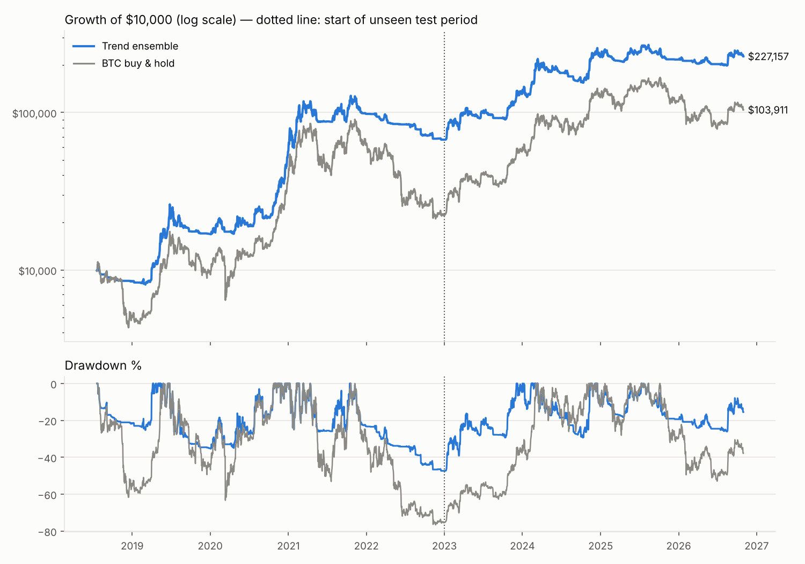

# Crypto strategy research — BTC trend ensemble

**Goal:** find a crypto strategy that is profitable *and* holds up out of sample, without
curve-fitting.

**Method:**
* Use well-documented effects only: trend-following and momentum.
* Use standard parameters and report every one tested.
* Test on 12 coins, including fading and delisted ones (EOS, XLM, ETC).
* In-sample 2018–2022, out-of-sample 2023 → Oct 2026.
* Include fees + slippage of 0.15% per trade.
* Robustness checks: 1-day late execution and double costs.

## The strategy

Daily, BTC spot, long or cash (no leverage, no shorting). Once a day at the daily close
(00:00 UTC), hold

> **BTC exposure = average of 5 trend signals**
> 1. close > 50-day SMA → 1 else 0
> 2. close > 100-day SMA → 1 else 0
> 3. close > 150-day SMA → 1 else 0
> 4. Donchian-20: becomes 1 on a close above the prior 20-day high, 0 on a close below the prior 10-day low
> 5. Time-series momentum: share of the 20/60/120-day returns that are positive (0, ⅓, ⅔, 1)

The rest of the account stays in USDT. Average exposure is 53%. On 31 Oct 2026 the
exposure is 53%.

The 5 signals are averaged rather than picking the "best" one. On BTC every setting from
50 to 150 days worked about equally well (Sharpe ≈ 1.0–1.4 in both periods), so averaging
them avoids betting on one lucky number.



| Period | Strategy | CAGR | Volatility | Sharpe | Max drawdown |
|---|---|---:|---:|---:|---:|
| 2018-07 → 2022 (in-sample) | **Ensemble** | **+53.4%** | 45% | **1.17** | **−47.4%** |
| | BTC buy & hold | +19.6% | 72% | 0.62 | −76.6% |
| 2023 → 2026-10 (out-of-sample) | **Ensemble** | **+37.4%** | 32% | **1.16** | **−29.4%** |
| | BTC buy & hold | +49.6% | 46% | 1.10 | −53.0% |
| Full 2018-07 → 2026-10 | **Ensemble** | **+45.8%** | 39% | **1.15** | **−47.4%** |
| | BTC buy & hold | +32.6% | 61% | 0.77 | −76.6% |

$10,000 → **$227k** (ensemble) vs $104k (buy & hold).

| Year | 2018 | 2019 | 2020 | 2021 | 2022 | 2023 | 2024 | 2025 | 2026 (to Oct) |
|---|---:|---:|---:|---:|---:|---:|---:|---:|---:|
| Ensemble | −15% | +100% | +235% | +73% | −31% | +96% | +72% | −4% | +5% |
| BTC buy & hold | −50% | +94% | +302% | +60% | −64% | +156% | +121% | −6% | −12% |

Robustness (full period): trading **1 day late** gives Sharpe 1.10, CAGR +42.9%. **Double
costs** give Sharpe 1.09, CAGR +42.6%.

## What to expect honestly

* **It lags in strong bull runs.** In 2023–2026 buy & hold made more (+49.6% vs +37.4% a
  year), because the strategy is only ~half invested and re-enters after the move starts.
  The edge is **risk**: similar or better return per unit of risk, and roughly **half the
  drawdown**.
* **It still loses money in bear years** (−15% in 2018, −31% in 2022), but far less than
  holding (−50%, −64%). A −47% drawdown is possible.
* **Not entirely free of hindsight.** The individual rules were fixed before testing, but
  choosing BTC over the altcoin portfolio was decided after seeing that trend-following on
  altcoins rarely beat holding them in 2023–2026. All the pre-set multi-coin versions were
  also profitable out-of-sample (table below), just with worse risk/return than BTC alone.
* Past performance is no guarantee. Trend-following has a long track record across markets,
  but it can go through multi-year flat periods.

## All pre-set strategies (`results/summary.csv`)

Equal-weight portfolios across the 12 coins (except the BTC rows):

| Strategy | IS CAGR | IS Sharpe | IS max DD | OOS CAGR | OOS Sharpe | OOS max DD |
|---|---:|---:|---:|---:|---:|---:|
| SMA-50 | 51.6% | 1.05 | −58.8% | 19.0% | 0.67 | −41.7% |
| SMA-100 | 37.8% | 0.87 | −71.6% | 16.2% | 0.59 | −36.3% |
| SMA-200 | 29.0% | 0.75 | −71.0% | 7.8% | 0.39 | −50.8% |
| Donchian-20 | 43.3% | 0.99 | −47.1% | 9.0% | 0.43 | −42.7% |
| Donchian-55 | 31.2% | 0.80 | −70.0% | 15.0% | 0.58 | −33.8% |
| TSMOM 20/60/120 | 40.8% | 0.91 | −66.6% | 17.5% | 0.64 | −36.3% |
| Top-3 momentum, 14d | 42.9% | 0.84 | −92.2% | 1.0% | 0.29 | −64.9% |
| Top-3 momentum, 28d | 66.4% | 1.02 | −80.8% | 5.8% | 0.37 | −69.3% |
| Top-3 momentum, 56d | 42.4% | 0.85 | −87.0% | 24.5% | 0.67 | −44.9% |
| Equal-weight buy & hold | 19.3% | 0.66 | −80.6% | 29.2% | 0.74 | −61.2% |
| BTC buy & hold | 19.6% | 0.62 | −76.6% | 49.6% | 1.10 | −53.0% |
| BTC only, SMA-100 | 58.9% | 1.19 | −38.8% | 35.0% | 1.02 | −36.8% |

Per-coin robustness is in `results/robustness_per_coin.csv`. Trend rules cut the drawdown
on 67–100% of coins in both periods, but on altcoins they rarely beat buy & hold's Sharpe
in 2023–2026.

## Reproduce

```bash
# daily data for the 12 coins -> data/daily/ (see download loop in the commit message / below)
for s in BTC ETH BNB XRP ADA LTC LINK TRX ETC XLM EOS BCH; do for y in 2018 2019 2020 2021 2022 2023 2024 2025 2026; do
  for m in 01 02 03 04 05 06 07 08 09 10 11 12; do f=${s}USDT-1d-$y-$m.zip
  curl -sSf -o data/daily/$f https://data.binance.vision/data/spot/monthly/klines/${s}USDT/1d/$f && unzip -oq -d data/daily data/daily/$f && rm data/daily/$f
  done; done; done
cd research
python3 crypto_trend.py        # all pre-set strategies, IS / OOS / full
python3 robustness.py          # every rule on every coin, late execution, 2x costs
python3 btc_trend_ensemble.py  # final strategy + chart
```

---

# EMA-50 first-touch strategy (daily) — `ema50_touch.py`

**Rules:** long only, daily candles.
1. Michael's EMA bands are green (EMA12 > EMA21).
2. EMAs are stacked EMA50 > EMA100 > EMA200.
3. Price touches EMA50 coming from above. Buy at the EMA50.
4. Only the **first** touch since the bands turned green.

The main exit is when the bands turn red. Costs are 0.15% per side, with no tuning.

**BTC result (2019-07 → 2026-10, 27 trades):** −46.4% total, 37% win rate, average trade −2.2%,
max drawdown −52%. BTC buy & hold over the same span made +949%.

**Why it fails:** when price pulls back to EMA50, the faster EMA12/21 bands are almost always
about to turn red. So the main exit fires 1–5 days after entry (time in market only 3%), and
the trade is closed at the bottom of the pullback.

| Exit (BTC) | Trades | Win % | Avg trade | Total | Max DD |
|---|---:|---:|---:|---:|---:|
| **Bands turn red (main)** | 27 | 37.0 | −2.2% | **−46.4%** | −52.0% |
| Close < EMA100 | 17 | 23.5 | +3.0% | +30.7% | −51.4% |
| Close < EMA200 | 12 | 25.0 | +20.9% | +116.7% | −66.3% |
| EMA stack breaks | 10 | 40.0 | +23.5% | +77.0% | −64.9% |
| Stop at EMA100, target 2R | 24 | 25.0 | −1.7% | −41.6% | −56.9% |

The slower exits make money, but every one of them is far below buy & hold (+949%), with
drawdowns of −51% to −66%.

On the other 11 coins (main exit), 8 of 12 coins end positive. The gains come almost
entirely from one or two huge trades (BNB +1,260%, ADA +1,029% in early 2021). Every coin
except ADA (and EOS, which fell) made less than simply holding it. Details are in
`results/ema50_touch_per_coin.csv`, the trades in `results/ema50_touch_btc_trades.csv`, and
the chart in `results/ema50_touch_btc.png`.
